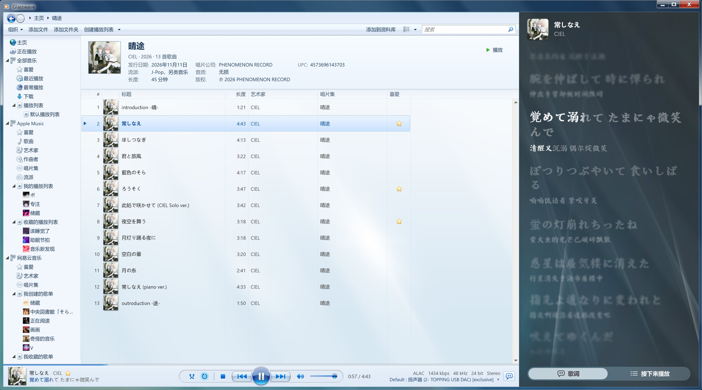
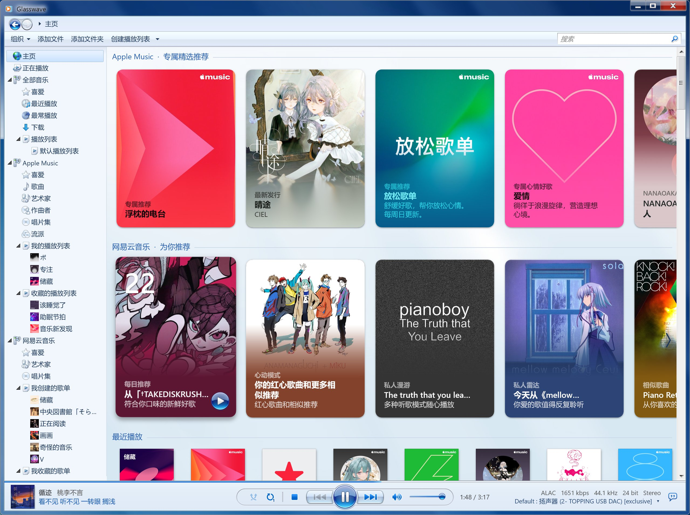
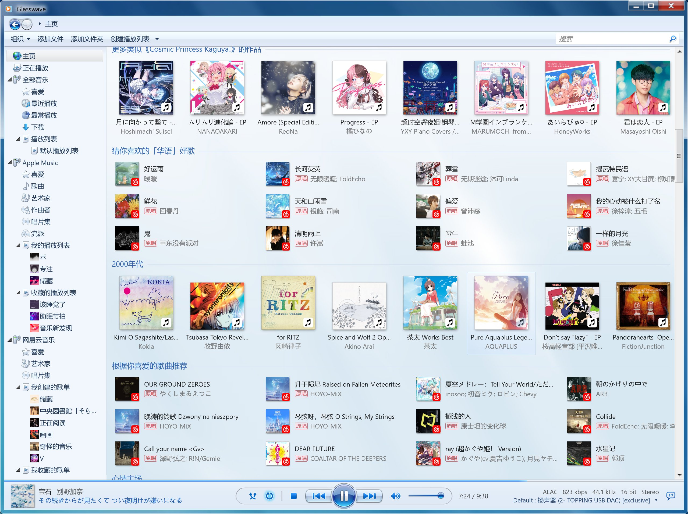
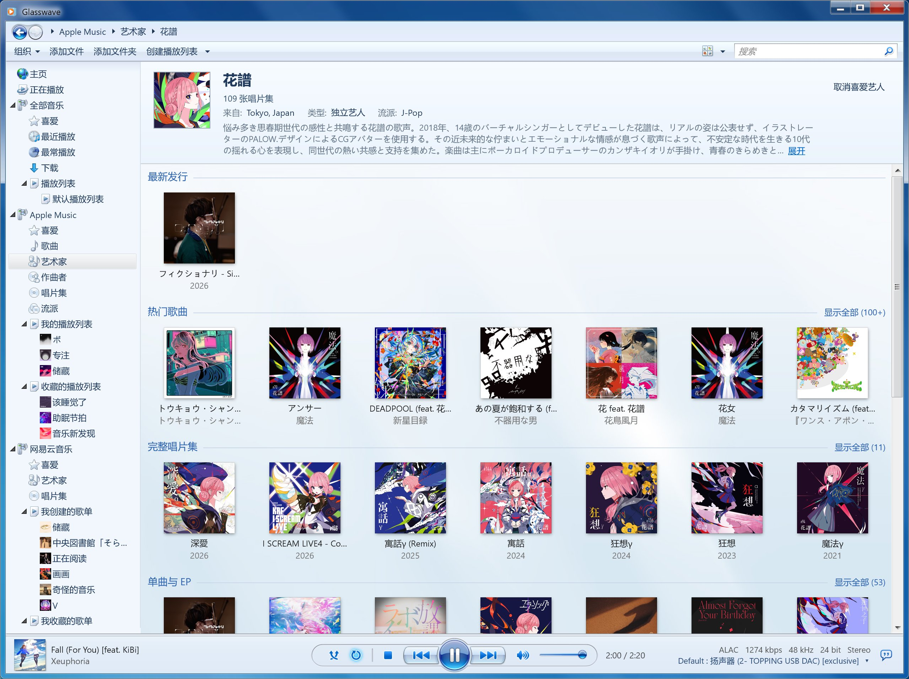
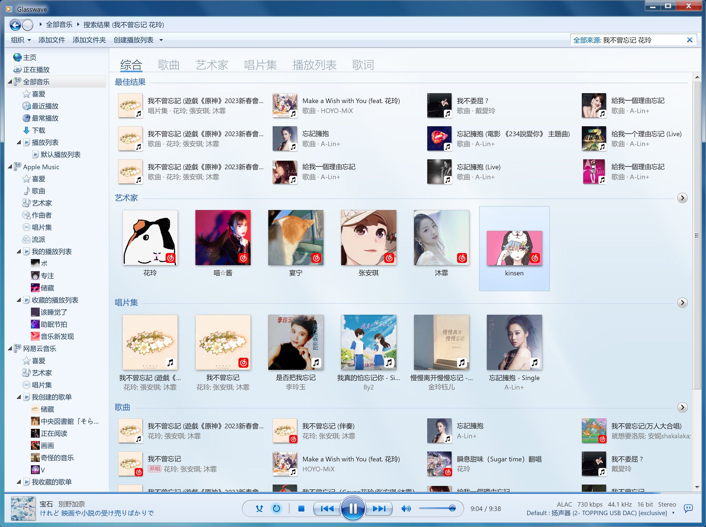
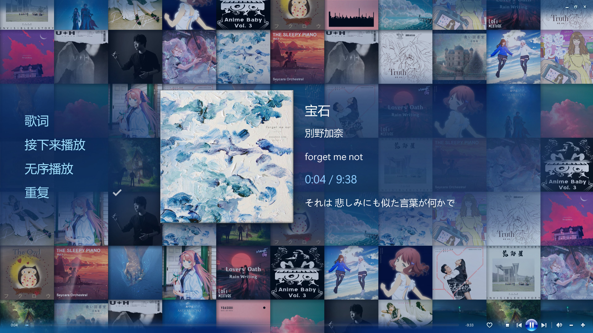
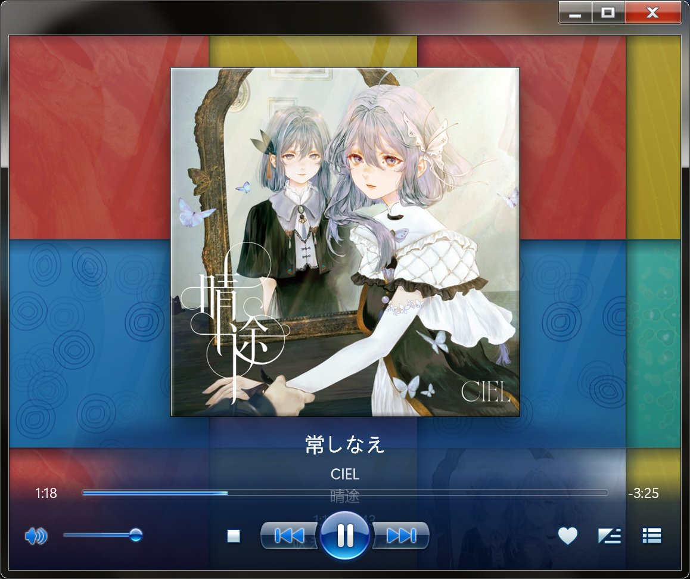
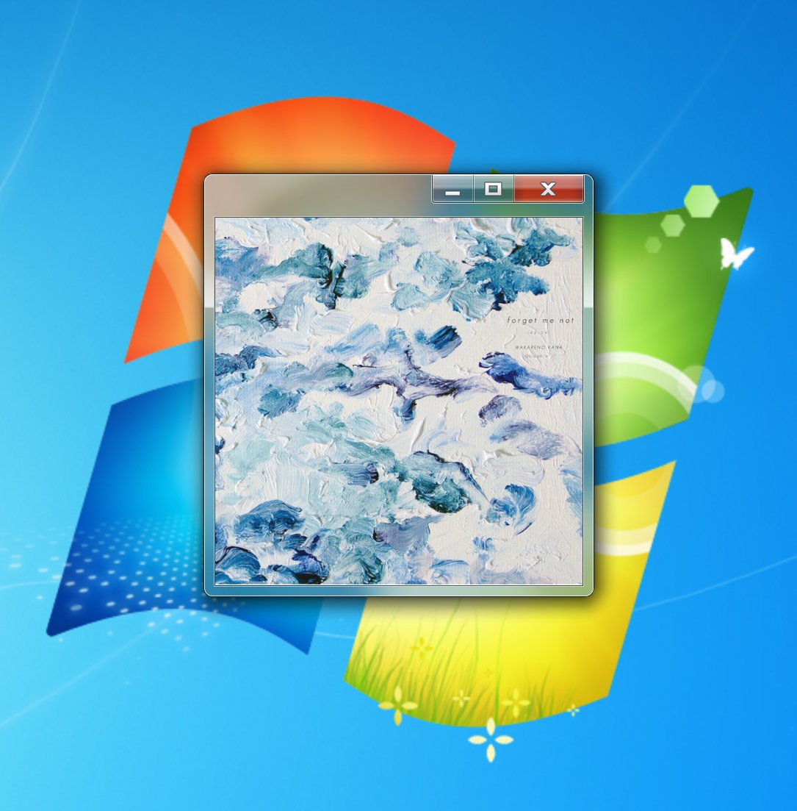
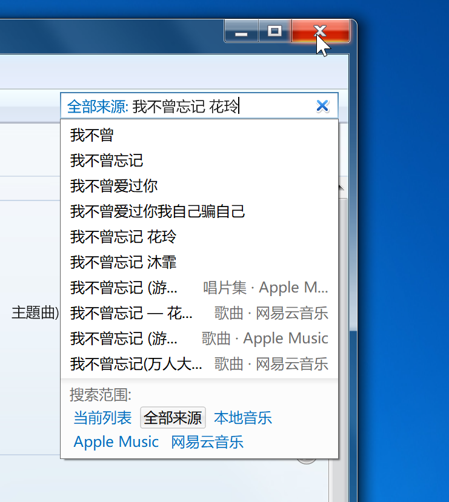

# Glasswave

A **foobar2000 2.x (x64)** user interface component (`foo_ui_glasswave.dll`) that recreates the
**Windows 7 Aero Glass** desktop, **Windows Media Player 12**, and **Windows Media Center**
look and feel on **Windows 11** — while leaving foobar2000's audio engine (decoding, playlists,
media library, DSP, WASAPI/ASIO output, and third-party components) untouched.

<p align="center">
  
  <br />
  <sub><b>WMP 12 Library &amp; Frosted Aero Now Playing Pane</b> — Album details, word-synced bilingual lyrics, WMP 12 transport controls, and lossless WASAPI exclusive output.</sub>
</p>

## Screenshots

### Unified Home, Artist Overview & Multi-Source Search

<table>
  <tr>
    <td width="50%" align="center" valign="top">
      
      <br />
      <sub><b>Unified Home</b> — Apple Music &amp; NetEase editorial cards side by side</sub>
    </td>
    <td width="50%" align="center" valign="top">
      
      <br />
      <sub><b>Cross-Provider Shelves</b> — Personalized recommendations with source badges</sub>
    </td>
  </tr>
  <tr>
    <td width="50%" align="center" valign="top">
      
      <br />
      <sub><b>Artist Overview</b> — Bio header, Latest Release, Top Songs &amp; expandable discography</sub>
    </td>
    <td width="50%" align="center" valign="top">
      
      <br />
      <sub><b>Unified Search</b> — WMC text tabs combining local &amp; streaming catalogs</sub>
    </td>
  </tr>
</table>

### Windows Media Center Full-Screen, Mini Player & Aero Details

<p align="center">
  
  <br />
  <sub><b>Windows Media Center Full-Screen Now Playing</b> — Mosaic album-art wall, live synced lyrics, and translucent WMC transport controls.</sub>
</p>

<table>
  <tr>
    <td width="35%" align="center" valign="top">
      
      <br />
      <sub><b>Mini Player</b> — Compact Aero Now Playing controls</sub>
    </td>
    <td width="33%" align="center" valign="top">
      
      <br />
      <sub><b>Compact Cover Mode</b> — Floating Win7 Aero glass frame</sub>
    </td>
    <td width="32%" align="center" valign="top">
      
      <br />
      <sub><b>Search &amp; Aero Chrome</b> — Live suggestions, scope switcher &amp; Win7 caption glow</sub>
    </td>
  </tr>
</table>

## Highlights

- **Scoped Aero Glass, zero system hacks**: Uses Windows 11's documented `HostBackdropBrush`
  through a Direct2D ColorMatrix implementing the Windows 7 DWM colorization formula, with
  screen-anchored reflection streaks, custom Win7 shadow frame, 16 Win7 tint presets (plus
  album-cover tint), and Windows 11 Snap Layouts support. Never patches system themes or hooks
  DWM.
- **Crisp Direct2D + Composition rendering**: Vector geometry with device-pixel-snapped
  hairlines and compositor-driven opacity/breathing animations; idle windows consume zero
  render ticks.
- **WMP 12 library & Now Playing experience**: Virtualized song tables, tile grids, artist /
  album / genre / playlist drill-down, unified catalog & list search, predictable occurrence-based
  shuffle/repeat queue, Audio CD playback with MusicBrainz metadata, and an integrated Now
  Playing side pane with word-by-word synced lyrics (`QuickJS` ESLyric-compatible script host)
  and live queue view.
- **Streaming providers & shared cache**:
  - **Apple Music**: Native Windows streaming with Lossless / Hi-Res ALAC decoding via
    foobar2000 and optional **Dolby Atmos (E-AC-3 JOC)** object rendering powered by Cavern
    (`glasswave_cavern.dll`).
  - **Cloud Genshin Music**: Streaming library, catalog search, playlists, and resumable
    multi-connection downloads (`aria2`).
  - **Shared SQLite WAL disk cache**: Configurable cache directory, per-account scopes,
    progressive audio caching, conditional cover revalidation, and stale-while-revalidate paged
    lists.
- **Clean distribution**: No Microsoft bitmaps or proprietary third-party binaries are committed
  to the repository or bundled in public releases. Original Windows 7 artwork and proprietary
  runtime libraries can be supplied locally at runtime (see
  [docs/deploy/user-install.md](docs/deploy/user-install.md)).
- **Localization & Preferences**: Built-in English and Simplified Chinese UI translations, and
  native foobar2000 Dark Mode support on the `Preferences → Display → Glasswave` page.

## Installation (End Users)

Requirements: **Windows 11 (build 22000+, x64)** and **foobar2000 2.x (64-bit)**.

1. Download `foo_ui_glasswave.fb2k-component` from the
   [Releases](../../releases) page.
2. In foobar2000, open **File → Preferences → Components**, click **Install...**, select
   `foo_ui_glasswave.fb2k-component`, and restart foobar2000.
3. Choose **Glasswave** as your User Interface module.

For configuring custom cache/download folders and supplying optional local assets (Windows 7
artwork, Apple Music Android `.so` libraries, additional lyric scripts), follow the complete
[End-User Installation SOP](docs/deploy/user-install.md).

## Building & Packaging from Source

Requirements: Windows 11 (22000+), Visual Studio 2022 (*Desktop development with C++*, v143,
Windows SDK 10.0.22000+), PowerShell 7.2+, and 7-Zip.

```powershell
pwsh -File scripts/bootstrap.ps1   # Fetch pinned foobar2000 SDK, quickjs-ng, miniz & portable dev host
pwsh -File scripts/build.ps1       # Build Release|x64 (0 warnings at /W4)
pwsh -File scripts/run-dev.ps1     # Deploy to isolated .local/fb2k-dev and launch
pwsh -File scripts/package.ps1     # Assemble dist/foo_ui_glasswave.fb2k-component
```

`bootstrap.ps1` unpacks a portable foobar2000 x64 instance into `.local/fb2k-dev` (signature-
and hash-verified; the installer is never executed). Development scripts touch only
`.local/fb2k-dev` and never modify any system foobar2000 installation.

## Documentation

- [Architecture Overview](docs/architecture.md) & [ADRs](docs/adr/)
- [Visual Specification](docs/design/visual-spec.md)
- [Deployment, Packaging & Operations SOPs](docs/deploy/README.md)
  - [End-User Installation SOP](docs/deploy/user-install.md)
  - [Release & Packaging SOP](docs/deploy/release-packaging.md)
  - [Personal Daily-Driver Setup & Update SOP](docs/deploy/personal-setup.md)
  - [Dev vs Prod Isolation & Cleanup SOP](docs/deploy/dev-vs-prod.md)
- [Third-Party Source & Dependency Maintenance Guide](docs/third-party.md)

## Repository Layout

| Path | Contents |
| --- | --- |
| `src/foo_ui_glasswave/` | Component source (C++20, Win32, Direct2D, Windows.UI.Composition) |
| `lang/` | UI translations bundled into `.fb2k-component` |
| `scripts/` | Bootstrap, build, dev deployment, packaging, and test scripts |
| `tests/` | Standalone unit tests |
| `third_party/` | Dependency lockfile (`deps.lock.json`) and Cavern C ABI adapter source |
| `docs/` | Architecture, ADRs, visual spec, deployment SOPs, and third-party guide |
| `dist/` | Packaged `.fb2k-component` release archives (gitignored) |
| `userdata/` | Optional local production cache & downloads storage (gitignored) |
| `.local/` | Dev sandbox, upstream build checkouts, local references (gitignored) |

## Licensing & Third-Party Notices

- **Glasswave**: Licensed under the [MIT License](LICENSE).
- **foobar2000 SDK**: Fetched at build time under its own BSD-style license (not vendored).
- **quickjs-ng** & **miniz**: Fetched at build time under MIT licenses.
- **Cavern**: Built separately as `glasswave_cavern.dll`; shipped with `Cavern-LICENSE.md` and
  `Cavern-NOTICE.md` inside `.fb2k-component`.
- **Apple Music bridge (`apple-music-linux` / `libhybris-win`)**: Built from pinned upstream
  sources + minimal tracked patches; shipped with upstream license notices inside
  `.fb2k-component`. Proprietary Apple Android `.so` files are never redistributed.
- See [docs/third-party.md](docs/third-party.md) for the complete inventory and license table.
